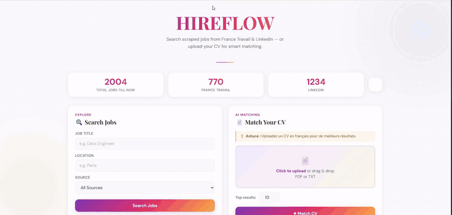
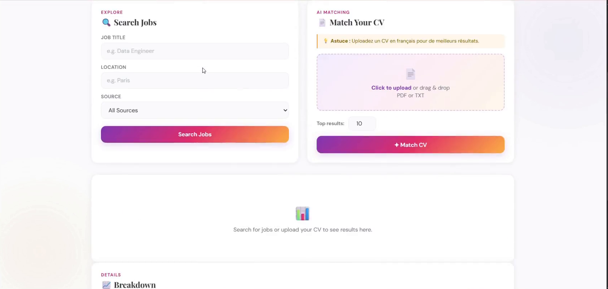
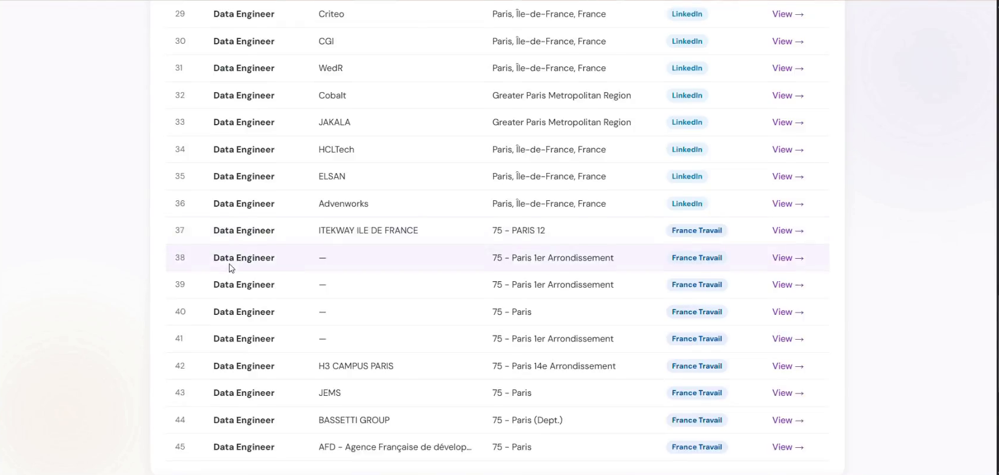
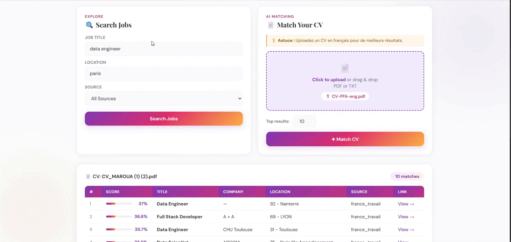
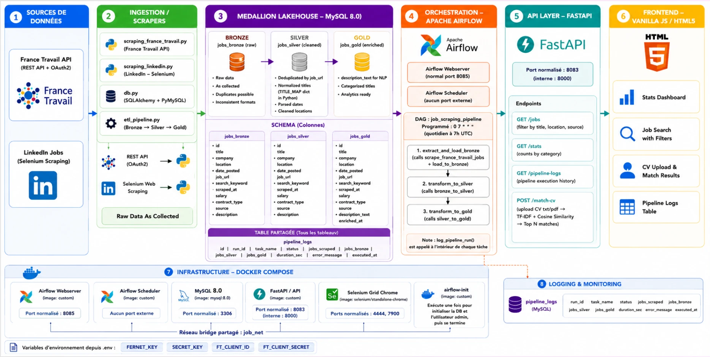
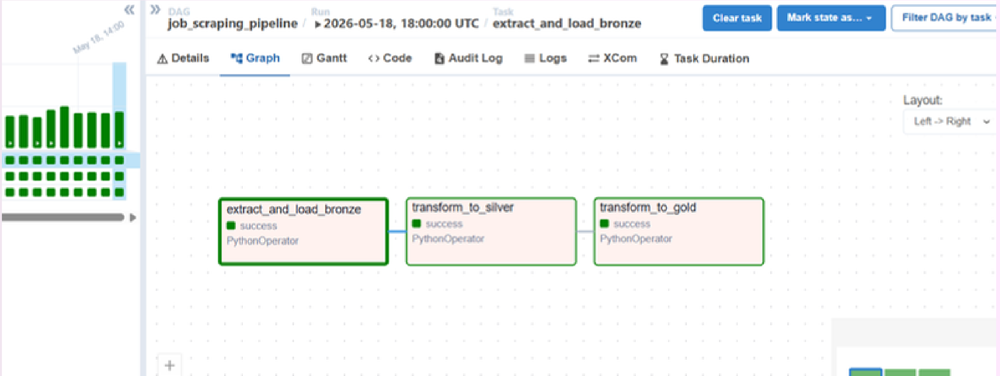
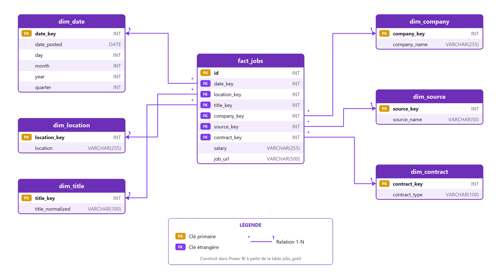
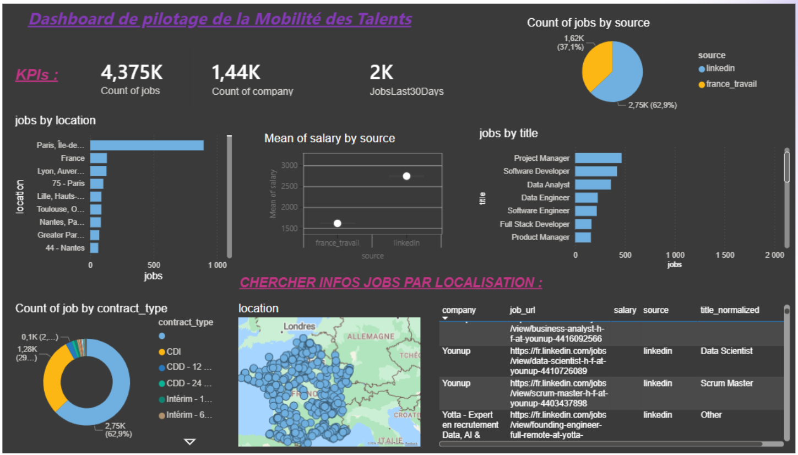
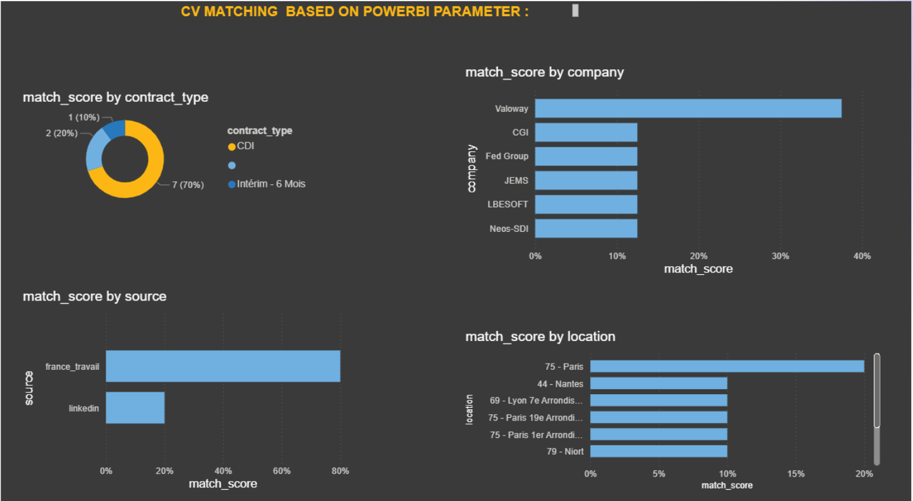

# 🎯 HireFlow

**Pipeline de données de bout en bout pour les offres d'emploi Tech : collecte automatisée, ETL Medallion, API REST et matching CV ↔ offres.**


> Projet académique · ENSA Al Hoceïma · Transformation Digitale & IA · 2025–2026



▶️ [Voir la vidéo de démo complète (MP4, 1 min 10)](docs/demo/hireflow-demo.mp4) · 📑 [Présentation du projet (PDF)](docs/Presentation-hireflow.pdf)

---

## 💡 Le projet

HireFlow collecte chaque jour des offres d'emploi Tech depuis **France Travail** (API REST OAuth2) et **LinkedIn** (Selenium). Les offres passent ensuite par un pipeline ETL en 3 couches (**Bronze → Silver → Gold**) orchestré par **Apache Airflow**. Les données obtenues sont exposées par une **API FastAPI**, exploitées dans un **dashboard Power BI** et utilisées par un moteur de **matching CV ↔ offres** (TF-IDF + similarité cosinus).

## 📊 Résultats

| Indicateur | Valeur |
|---|---|
| Sources de données | 2 (France Travail, LinkedIn) |
| Mots-clés de recherche | 28 |
| Offres collectées par exécution | ~768 |
| Durée d'une exécution du pipeline | ~85 s |
| Offres analysées dans le dashboard | 4 375 |
| Entreprises distinctes | ~1 440 |

## 🖥️ Aperçu de l'application

| Accueil | Recherche d'offres | Matching CV |
|---|---|---|
|  |  |  |

## 🏗️ Architecture



| Couche | Rôle |
|---|---|
| **Bronze** | Données brutes, telles que collectées |
| **Silver** | Suppression des offres sans URL, dédoublonnage sur `job_url`, normalisation des intitulés (`TITLE_MAP`), parsing des dates |
| **Gold** | `description_text` prêt pour le NLP (repli sur intitulé + lieu + contrat si la description est vide), données prêtes pour la BI |

Chaque tâche écrit dans une table `pipeline_logs` : statut, volumes par couche, durée et erreurs.

### Orchestration Airflow

DAG `job_scraping_pipeline` exécuté chaque jour (`0 7 * * *`), avec 1 relance automatique en cas d'échec :

```
extract_and_load_bronze  >>  transform_to_silver  >>  transform_to_gold
```



### Modèle de données (analytique)

Schéma en étoile construit dans Power BI à partir de `jobs_gold` : `fact_jobs` + dimensions date, location, title, company, source et contract.



## 🧠 Matching CV ↔ offres

```
CV (PDF/TXT) → extraction du texte → TF-IDF (CV + offres Gold) → similarité cosinus → Top N offres
```

## 🚀 API FastAPI

| Endpoint | Description |
|---|---|
| `GET /jobs` | Recherche d'offres (filtres titre, localisation, source) |
| `GET /stats` | Statistiques du marché |
| `GET /pipeline-logs` | Historique des exécutions du pipeline |
| `POST /match-cv` | Upload d'un CV → offres les plus pertinentes |

Documentation Swagger : `http://localhost:8083/docs`

## 📈 Dashboards Power BI

**Pilotage du marché** : KPIs (4 375 offres, ~1 440 entreprises), répartition par source, localisation, intitulé et type de contrat, salaire moyen par source et carte des offres.



**Matching CV** : score de correspondance par type de contrat, entreprise, source et localisation.



## 🛠️ Stack technique

| Domaine | Technologies |
|---|---|
| Collecte | Requests (API OAuth2), Selenium, BeautifulSoup |
| Data Engineering | Python, pandas, SQLAlchemy |
| Orchestration | Apache Airflow 2.9 |
| Base de données | MySQL 8.0 |
| Backend | FastAPI, Uvicorn |
| NLP | scikit-learn (TF-IDF, cosinus), PyPDF2 |
| Frontend | HTML, CSS, JavaScript |
| BI | Power BI |
| Infra | Docker, Docker Compose |

## ⚙️ Lancer le projet

**Prérequis :** Docker, Docker Compose et des identifiants [API France Travail](https://francetravail.io).

```bash
git clone https://github.com/hajaryaz/HireFlow.git
cd HireFlow
cp .env.example .env        # puis remplir les clés
docker compose up -d --build
docker compose exec airflow-scheduler airflow dags trigger job_scraping_pipeline
```

| Service | URL |
|---|---|
| Airflow | http://localhost:8085 (admin / admin) |
| API + Swagger | http://localhost:8083/docs |
| Interface Web | ouvrir `frontend/index.html` |

## 📁 Structure

```
HireFlow/
├── api/            # API FastAPI + matching CV
├── dags/           # DAG Airflow
├── scrapers/       # Scrapers + pipeline ETL
├── sql/            # Schéma MySQL (Bronze/Silver/Gold/logs)
├── frontend/       # Interface web
├── docs/           # Captures, démo vidéo et présentation
└── docker-compose.yml
```

## 🔭 Perspectives

- Matching sémantique (embeddings) en remplacement de TF-IDF
- Tests de qualité des données automatisés
- Nouvelles sources d'offres
- Déploiement cloud

## ⚠️ Avertissement

Projet réalisé à des fins pédagogiques. Le scraping de LinkedIn est soumis à ses conditions d'utilisation.

## 👩‍💻 Équipe

**Hajar ELYAZRI** · **Maroua ALAMI HARRAK**
