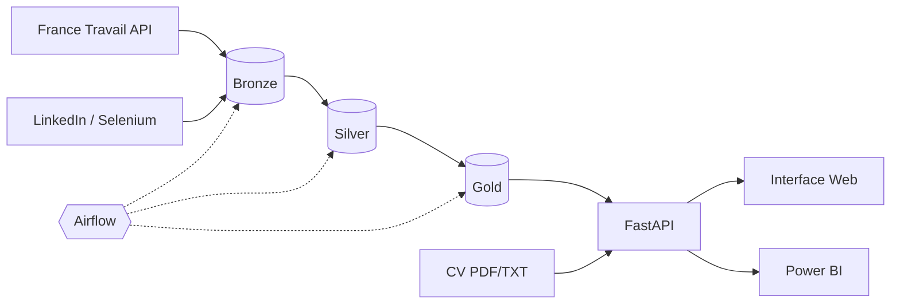

<div align="center">

# 🎯 HireFlow

**Plateforme de collecte, de traitement et de matching d'offres d'emploi Tech**

[](https://www.python.org/)
[](https://airflow.apache.org/)
[](https://fastapi.tiangolo.com/)
[](https://www.mysql.com/)
[](https://scikit-learn.org/)
[](https://www.docker.com/)
[](https://www.microsoft.com/power-platform/products/power-bi)

*Projet de Fin d'Études · ENSA Al Hoceïma · Transformation Digitale & IA · 2025–2026*


</div>

---

## 💡 Le projet

**HireFlow** est une plateforme de collecte, traitement et analyse d'offres d'emploi Tech.

Elle automatise la chaîne de données, de la **collecte des offres** à leur transformation avec une architecture **Medallion (Bronze → Silver → Gold)**, puis expose les données via une **API FastAPI** et propose un **matching CV ↔ offres** basé sur TF-IDF et la similarité cosinus.

Les données sont également exploitées dans un **dashboard Power BI**, avec une infrastructure conteneurisée via **Docker Compose**.

---

## ✨ Fonctionnalités

* 🔎 **Collecte automatisée** des offres via l'API France Travail et Selenium.
* 🧹 **Pipeline ETL Medallion** : Bronze → Silver → Gold.
* ⚙️ **Orchestration avec Apache Airflow**.
* 📊 **Monitoring** des exécutions et des volumes traités.
* 🚀 **API REST FastAPI** pour la recherche, les statistiques et le matching.
* 🧠 **Matching CV ↔ offres** avec TF-IDF + similarité cosinus.
* 🖥️ **Interface Web** pour explorer les offres et effectuer un matching.
* 📈 **Dashboard Power BI** pour analyser les données collectées.
* 🐳 **Déploiement local conteneurisé** avec Docker Compose.

---

## 🏗️ Architecture

<p align="center">
  
</p>



**Bronze** → données brutes
**Silver** → données nettoyées, normalisées et dédupliquées
**Gold** → données préparées pour le NLP et la BI

---

## 🛠️ Stack technique

| Domaine          | Technologies                      |
| ---------------- | --------------------------------- |
| Data Engineering | Python, pandas, NumPy             |
| Orchestration    | Apache Airflow                    |
| Backend / API    | FastAPI, Uvicorn                  |
| Database         | MySQL, SQLAlchemy, PyMySQL        |
| NLP              | scikit-learn, TF-IDF, PyPDF2      |
| Collecte         | Requests, Selenium, BeautifulSoup |
| Frontend         | HTML, CSS, JavaScript             |
| BI               | Power BI                          |
| Infrastructure   | Docker, Docker Compose            |

---

## 🧠 Matching CV

Le CV est transformé en représentation **TF-IDF**, puis comparé aux descriptions des offres grâce à la **similarité cosinus** afin de retourner les offres présentant les scores les plus élevés.

```text
CV PDF / TXT
     ↓
Extraction du texte
     ↓
TF-IDF
     ↓
Similarité cosinus
     ↓
Top N offres
```

---

## 📊 Résultats

D'après le rapport et les captures de démonstration :

| Indicateur                         | Résultat |
| ---------------------------------- | -------: |
| Mots-clés de collecte              |       28 |
| Offres collectées par run          |     ~768 |
| Durée du pipeline observé          |    ~85 s |
| Offres affichées dans le dashboard |    4 375 |
| Entreprises distinctes             |  ~1,44 K |

<p align="center">
  
  
</p>

---

## 🚀 Démarrage rapide

### Prérequis

* Docker + Docker Compose
* Identifiants API France Travail

```bash
git clone https://github.com/<votre-compte>/HireFlow.git
cd HireFlow
docker compose up -d --build
```

Créer un fichier `.env` :

```env
FERNET_KEY=...
SECRET_KEY=...
FT_CLIENT_ID=...
FT_CLIENT_SECRET=...
```

Déclencher le pipeline :

```bash
docker compose exec airflow-scheduler airflow dags trigger job_scraping_pipeline
```

| Service       | Accès                        |
| ------------- | ---------------------------- |
| Airflow       | `http://localhost:8085`      |
| API + Swagger | `http://localhost:8083/docs` |
| Interface Web | `frontend/index.html`        |

---

## 🔭 Perspectives

* Enrichissement avec de nouvelles sources d'emploi.
* Évolution vers un matching sémantique.
* Gestion des profils CV et authentification.
* Déploiement sur une infrastructure distante.

---

## 👩‍💻 Équipe

**Hajar ELYAZRI · Maroua ALAMI HARRAK**

**ENSA Al Hoceïma · Transformation Digitale & Intelligence Artificielle · 2025–2026**
